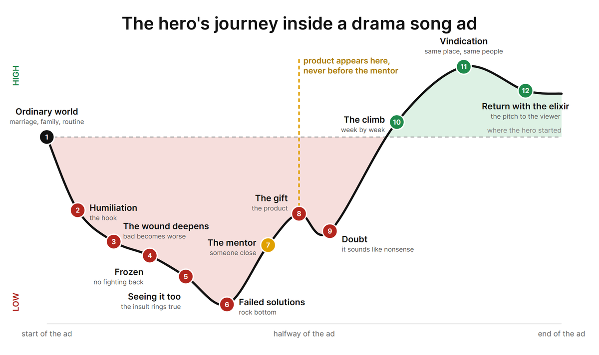
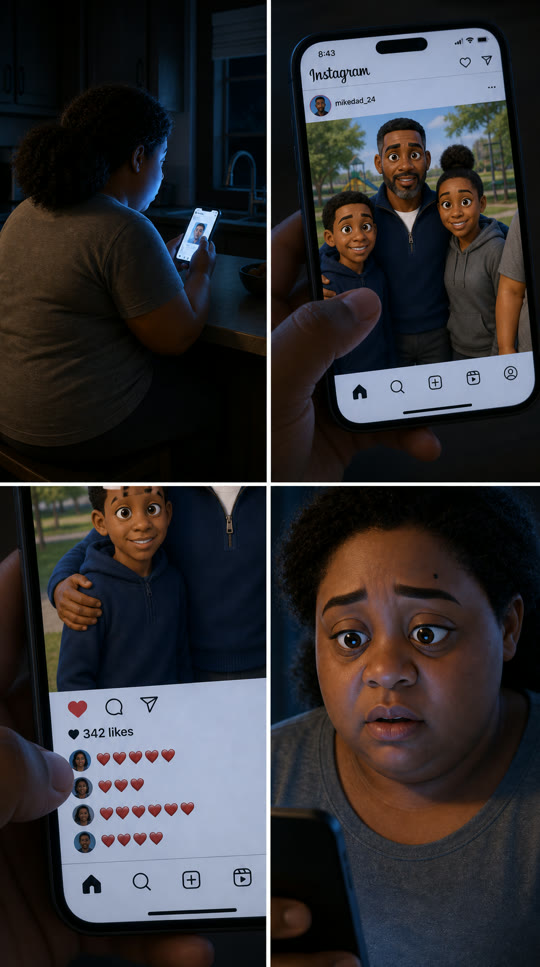
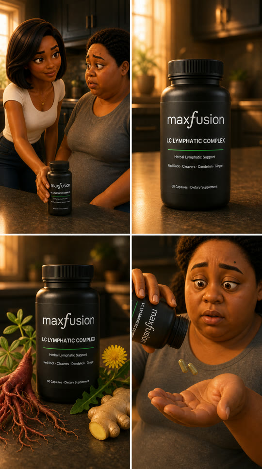

# Drama Song Ad

A free Claude skill that makes a complete drama song ad: a seven-to-ten-minute ad sung in the first person, told as a drama. The hero falls, a close friend brings the product, and the hero rises. Every shot shows the line being sung.

One skill takes you from nothing to the finished video, all from chat:

1. Intake: your product, your buyer, your offer
2. Three story arcs to pick from
3. A twelve-stage outline
4. The full sung script
5. The song (Suno V5.5)
6. A word-by-word timing map
7. The shot plan
8. Character sheets
9. Shot sheets (four-panel storyboards)
10. Video clips (Seedance 2.0)
11. The final edit, cut to the song

Always 9:16, always 1080p. The default look is a 3D animated feature film. Nothing is generated until you approve it.

## Works with any generation tools

Originally designed for the MaxFusion AI MCP, the skill is tool-agnostic. It works with any tools that generate images, audio and video: another MCP, your own API keys, or by hand. With no tools connected, it gives you every prompt ready to paste into tools like Suno and guides you step by step.

## The story shape



The product never appears before the mentor, and the pitch is only the last sixty to ninety seconds.

## Example

A drama song ad for a lymphatic supplement.

**Character sheet** (the hero before the change)


**Shot sheets** (each one becomes one video clip)

 

**Final video** (click to play)

<a href="https://cdn.maxfusion.ai/b187ee20-43c0-42e3-882a-91028682f9be.mp4"></a>

## Requirements

- Claude Code (or any Claude client that loads skills)
- Tools that generate images, audio and video: the [MaxFusion AI MCP](https://maxfusion.ai) (recommended), another MCP, your own API keys, or none (manual mode)
- [faster-whisper](https://github.com/SYSTRAN/faster-whisper) (Python) for word timing
- [ffmpeg](https://ffmpeg.org) for the edit

## Install

Copy this folder into your skills folder:

```bash
git clone https://github.com/holy-templar/drama-song-ad.git ~/.claude/skills/drama-song-ad
```

Then ask Claude: "Make a drama song ad for my product."

## License

MIT. See [LICENSE](LICENSE).
